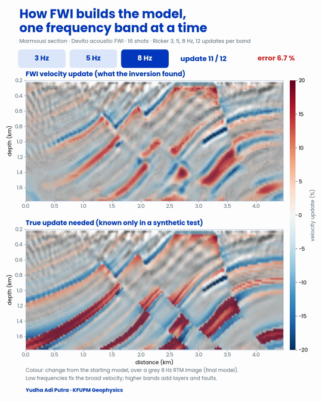

# Full Waveform Inversion exercises with Devito

The notebook walks through the core pieces of acoustic FWI on a 2-D Marmousi section, from forward modeling
to a complete multiscale inversion, using [Devito](https://github.com/devitocodes/devito) v4.8.23.



## Contents

| Path | What it is |
|---|---|
| `FWI_Devito_Exercises.ipynb` | The five exercises, with all outputs saved |
| `figs/` | Figures produced by the notebook (used in the report) |
| `animation/run_fwi.py` | Re-runs the 3 → 5 → 8 Hz inversion and saves the model after every update |
| `animation/render.py` | Turns those snapshots into the time-lapse video |
| `animation/FWI_frequency_timelapse.mp4` | The resulting video (23 s, 1080 × 1350) |

## The exercises

| # | Exercise | Based on | Main result |
|---|---|---|---|
| 1 | Forward modeling | Devito `01_modelling.ipynb`; Louboutin et al. (2017) | Wavefield snapshots and a shot gather with direct, reflected and diving waves |
| 2 | Numerical accuracy | Devito `space_order` / `critical_dt` | Second-order stencils disperse on a coarse grid; 8th-order stays close to the reference |
| 3 | Adjoint gradient and Taylor test | Devito `03_fwi.ipynb`, `test_gradient.py`; Louboutin et al. (2018) | Taylor-test slopes 0.95 and 1.83 (expected 1 and 2): the gradient is correct |
| 4 | Multiscale FWI of Marmousi | `03_fwi.ipynb` + SciPy L-BFGS-B; Witte et al. (2018) | Model error 10.2 % → 7.7 % (3 Hz) → 6.5 % (5 Hz) → 5.9 % (8 Hz) |
| 5 | Cycle skipping and the misfit landscape | Own experiment, after Bunks et al. (1995) | The 9 Hz misfit has false minima close to the true model (α = 1.10, 1.25) that the 3 Hz misfit does not |

**Set-up of Exercise 4.** 4.5 km × 1.8 km section resampled to 25 m, 16 shots and 181 receivers at 12.5 m depth,
3 s recording, starting model = true model smoothed with a 150 m Gaussian (water layer kept), Ricker bands
3 → 5 → 8 Hz with 20 L-BFGS-B iterations each, velocity bounds 1.5–4.7 km/s and an illumination preconditioner.
The observed data are simulated with the same code and contain no noise (an *inverse crime*), so the numbers are
an upper bound on what field data would give.

## Running the notebook

```bash
git clone https://github.com/yudhaadi77/fwi-excercise.git
cd fwi-excercise
git clone --branch v4.8.23 https://github.com/devitocodes/devito.git
git clone https://github.com/devitocodes/data.git devito-data
pip install -r requirements.txt
jupyter notebook FWI_Devito_Exercises.ipynb
```

The notebook looks for `./devito` and `./devito-data`; set the environment variables `DEVITO_REPO` and `DATA_PATH`
to use other locations. A full run takes about 30 minutes on a laptop CPU; start Jupyter with the environment
variable `FAST=1` for a quicker, rougher run.

## Time-lapse video

The video shows the FWI velocity update (percent change from the starting model) building up over the
three frequency bands, 12 updates each, laid over an 8 Hz RTM image. The lower panel shows the update that
was actually needed (true model minus starting model), which is known only because the test is synthetic.

```bash
cd animation
DEVITO_REPO=../devito DATA_PATH=../devito-data python run_fwi.py   # about 10 minutes, writes fwi_frames.npz
python render.py                                                    # writes FWI_frequency_timelapse.mp4 (needs ffmpeg)
```

With 12 updates per band the final model error is 6.7 %, slightly higher than the 5.9 % of Exercise 4,
which uses 20 updates per band.

## Data and credits

- Devito and its seismic tutorials: [devitocodes/devito](https://github.com/devitocodes/devito) (MIT License).
  The exercises follow and extend its tutorials `01_modelling` and `03_fwi`.
- Marmousi velocity model (Versteeg, 1994): `Simple2D/vp_marmousi_bi` from
  [devitocodes/data](https://github.com/devitocodes/data). The data are not included in this repository.

## References

- Bunks, C., Saleck, F. M., Zaleski, S., and Chavent, G. (1995). Multiscale seismic waveform inversion. *Geophysics*, 60(5), 1457–1473.
- Louboutin, M., et al. (2017). Full-waveform inversion, Part 1: Forward modeling. *The Leading Edge*, 36(12), 1033–1036.
- Louboutin, M., et al. (2018). Full-waveform inversion, Part 2: Adjoint modeling. *The Leading Edge*, 37(1), 69–72.
- Louboutin, M., et al. (2019). Devito (v3.1.0): an embedded domain-specific language for finite differences and geophysical exploration. *Geoscientific Model Development*, 12(3), 1165–1187.
- Luporini, F., et al. (2020). Architecture and performance of Devito, a system for automated stencil computation. *ACM Transactions on Mathematical Software*, 46(1), Article 6.
- Versteeg, R. (1994). The Marmousi experience: Velocity model determination on a synthetic complex data set. *The Leading Edge*, 13(9), 927–936.
- Virieux, J., and Operto, S. (2009). An overview of full-waveform inversion in exploration geophysics. *Geophysics*, 74(6), WCC1–WCC26.
- Witte, P., et al. (2018). Full-waveform inversion, Part 3: Optimization. *The Leading Edge*, 37(2), 142–145.

## License

MIT, see [LICENSE](LICENSE).
